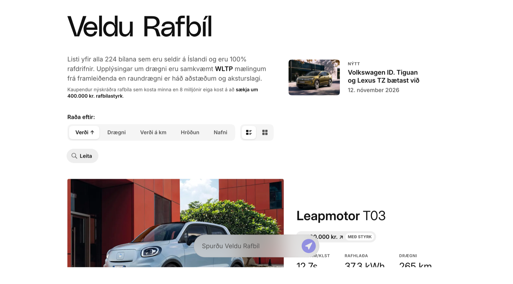

# Veldu Rafbíl

**Every new electric car on sale in Iceland, in one list.** Prices after the
government grant, filters and comparisons, and an AI advisor that answers in
Icelandic.

**[veldurafbil.is](https://veldurafbil.is)**

[](https://veldurafbil.is)

_Veldu rafbíl_ is Icelandic for _choose an electric car_. Each importer keeps
their own price list in their own format, and the grant changes what a buyer
actually pays. This site puts all of it in one place, so it is easy to see
what is on sale and which car fits. It is a non-profit side project, kept up
by hand since 2019.

## What it does

- **The list**: every 100% electric car sold new in Iceland, sorted and
  filtered by price, range, charging, seats and more. The sorting and filters
  live in the URL, so a shared link opens the same view.
- **Prices people actually pay**: the grant is already taken off where a car
  qualifies, and range is shown as an Icelandic real-world estimate next to
  the WLTP figure.
- **Car pages**: a written review of each car, plus its price and delivery
  history.
- **Comparisons**: cars side by side, with a written verdict.
- **[Uppfærslur](https://veldurafbil.is/uppfaerslur)**: new cars, price changes
  and delivery estimates by day, with an RSS feed.
- **The advisor**: ask questions about the cars in Icelandic and get answers
  based on the list.
- **Open data**: the whole list as JSON, [described below](#the-car-list-as-json).

The site is in Icelandic. The code, the commits and this README are in English.

## Running it

You need a Node.js version allowed by `engines` in [package.json](package.json).

```bash
npm install
npm run dev
```

The site itself needs no configuration. The AI features also need a
[Google AI Studio](https://aistudio.google.com) key in `.env.local`:

```
GOOGLE_GENERATIVE_AI_API_KEY=...
```

Next.js App Router, TypeScript, Tailwind v4, deployed on Vercel.

## Contributing

Corrections and new cars are the most useful help, and the first one needs no
code.

**Spotted a wrong price, a missing car or a broken link?**
[Open an issue](https://github.com/hugihlynsson/veldu-rafbil/issues/new/choose)
and link the seller's page or price list. Prices are copied by hand from those
lists, so a link to the source is all it takes to fix one.

**Adding or updating a car** is an edit to
[`modules/data/newCars.ts`](modules/data/newCars.ts), one entry per variant.
Its tests check every entry against the schema. The
[`update-new-cars`](.claude/skills/update-new-cars/SKILL.md) skill walks
through the process: what counts as a separate entry, and where to find each
make's price list and photos. It is written for coding agents, and works
just as well as a checklist for people.

**Changing the code?** [AGENTS.md](AGENTS.md) has the repo's conventions. Before opening a pull request, run:

```bash
npm test && npm run typecheck && npm run lint
```

For anything beyond a data edit, run `npm run build` too. A pre-commit hook
does the formatting.

## The car list as JSON

[`/api/cars`](https://veldurafbil.is/api/cars) publishes every car as one
document. There is no key and no rate limit, and it is cached at the edge,
since it is built at deploy rather than per request. The fields are named so
they can be read without this repo at hand. `price.list` and `price.withGrant`
are separate, because a new electric car under the price ceiling gets a
government grant, and `price.withGrant` is what a buyer pays. Range is WLTP,
with an Icelandic real-world estimate next to it. The envelope carries the
grant figures, those caveats and a `generatedAt` timestamp.

[`/llms.txt`](https://veldurafbil.is/llms.txt) is the short version of the
same information, for AI agents, following the
[llms.txt convention](https://llmstxt.org). `/robots.txt` lets crawlers read
both and keeps them off `/api/chat` and `/api/verdict`, which bill a hosted
model on every call.

Prices come from the sellers' published price lists and are updated by hand,
so they can be out of date. Credit and a link back are appreciated.

## License

The code is [MIT](LICENSE). The car photos in `public/images` belong to the
manufacturers and importers. They are not covered by the license and are
served for this site only.
